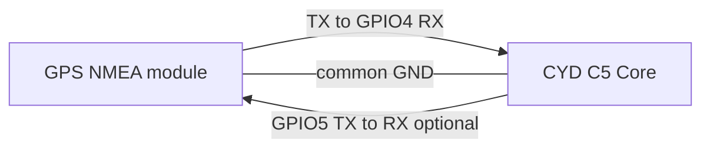
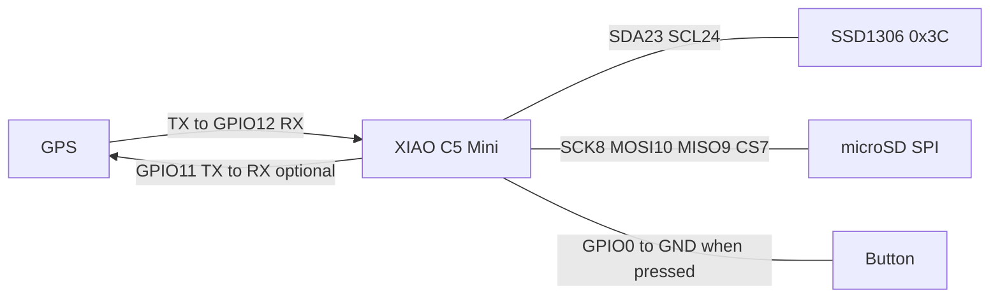

# Code-derived wiring diagrams
These diagrams cover signal direction. Confirm module power ratings and connector labels before applying power. Integrated board wiring is described in ../docs/HARDWARE.md and is not a replacement for manufacturer schematics.

All connected modules share GND. GPS serial configuration is 9600 baud in the selected recorder sources. Mesh nodes connect wirelessly to CYD, not to GPS UART wires. No verified photographs or manufacturer wiring drawings are redistributed here.
